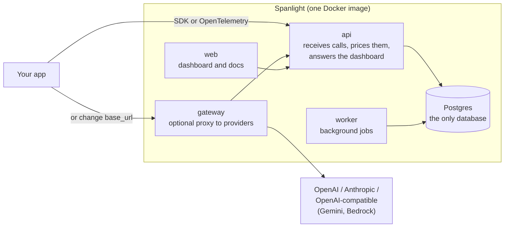

<div align="center">


# Spanlight

**Open-source observability for LLM applications, on one Postgres.**

[](https://github.com/dheerajkarwasra/spanlight/actions/workflows/ci.yml)
[](https://github.com/dheerajkarwasra/spanlight/actions/workflows/codeql.yml)
[](https://pypi.org/project/spanlight/)
[](LICENSE)

[Live demo](https://spanlight.dev) · [Docs](https://spanlight.dev/docs/) · [Features](#features) · [Getting started](#getting-started) · [How it works](#how-it-works) · [Discussions](https://github.com/dheerajkarwasra/spanlight/discussions)

</div>

Spanlight records every LLM call your application makes: prompts and completions, latency, time to first token, tokens, cost and errors, grouped into traces and user sessions. Send traces with the Python or TypeScript SDK, any OpenTelemetry exporter over OTLP/HTTP, or by changing one `base_url` to the built-in gateway. Then go past tracing: audit what each call cost, check it against the provider's bill, find out why calls fail, and review yesterday's traffic every morning.

> [!TIP]
> Want to look before you install? The [live demo](https://spanlight.dev) runs on real Claude calls under a small monthly budget.

## Features

- **Trace explorer and sessions.** Search traces by name or by what the model was sent and said, read a span waterfall with agent, tool and model steps, compare two traces step by step, and replay multi-turn conversations as chat with cost and latency per turn. Inputs and outputs are kept up to 1 MB each, so long RAG contexts stay readable.
- **Cost you can audit.** Prices come from a versioned table that covers cache writes, long-prompt tiers, batch, flex and priority rates, and web search fees. Every call has a line-by-line cost breakdown. A cost that cannot be known shows as _unknown_ with the reason, never as $0.
- **Checked against the bill.** Connect an Anthropic or OpenAI admin key, or upload a CSV, and Spanlight compares traced spend with what the provider billed, every day.
- **Attribution and budgets.** Tag traces with up to 32 metadata pairs (customer, feature, team) and see spend, calls and errors per value. Budgets can alert on, or block, spend per project, gateway key, user, model, metadata pair or trace name.
- **The Doctor and provider health.** Fifteen deterministic detectors flag known failure patterns (retry storms, ignored `Retry-After`, truncated outputs, tool loops, cost and latency spikes and more), each with its evidence and a suggested fix. Provider health tells a provider outage or rate limit apart from your own bug, with the provider's status page incidents alongside.
- **A gateway for OpenAI and Anthropic.** Gemini and Bedrock work through their OpenAI-compatible endpoints, with cost unknown until you add a price for their models. The official SDKs work against it unchanged, streaming and tool calls included. It adds sealed provider credentials, routes with retries and fallbacks, per-key rate limits, an exact-match cache, and an Integration Lab that injects real provider failures on non-production keys.
- **Prompts, evals and a daily review.** Versioned prompts with labels, a playground, exact replay of any recorded call, datasets, experiments with 95% confidence intervals on pass rates, and a nightly queue of the traces worth reading. LLM judges show their agreement with your reviewers (κ, F1, confusion matrix).
- **OpenTelemetry native.** `POST /v1/otlp/traces` (OTLP over HTTP, as JSON or protobuf; gRPC through an [OpenTelemetry Collector](https://spanlight.dev/docs/otlp/#sending-from-a-grpc-exporter)) reads the GenAI conventions (`gen_ai.*`, also written by LiteLLM), OpenInference, OpenLLMetry (Traceloop) and the Vercel AI SDK, and counts usage once across nested spans. Recorded fixtures cover LangChain, LangGraph, LlamaIndex, Pydantic AI and the OpenAI Agents SDK. A Python SDK is on PyPI; a TypeScript SDK for Node.js is in [`sdks/typescript/`](sdks/typescript/) (its npm release job is ready; install it from a tarball until the first release).
- **Built for teams, private by design.** Organizations, projects, roles, scoped API keys and an audit log. Postgres row-level security isolates every project's data, and secrets are redacted from payloads before storage.
- **Self-hosted on one database.** Postgres is the only datastore, the job queue included. The core is MIT licensed.

> [!NOTE]
> Spanlight is pre-1.0. The current server release is 0.7.0 ([changelog](CHANGELOG.md)), and the Python SDK on PyPI is 0.2.1.

## Getting started

### Prerequisites

- [Docker](https://docs.docker.com/get-docker/) with Compose v2
- Python 3.10 or newer for the SDK
- An OpenAI or Anthropic API key in your own application

### 1. Start Spanlight

```bash
git clone https://github.com/dheerajkarwasra/spanlight.git
cd spanlight
cp deploy/.env.example deploy/.env    # fill in POSTGRES_PASSWORD, APP_DB_PASSWORD and SECRET_KEY
docker compose -f deploy/compose.yaml --env-file deploy/.env up -d
```

This pulls the released images named in `deploy/.env` (`SPANLIGHT_IMAGE` and `SPANLIGHT_WEB_IMAGE`). To build from the checkout instead, comment out those two lines and add `--build`.

Open http://localhost:8080, create an account, and follow the setup wizard to create a project and an API key.

> [!TIP]
> Generate each secret with `python3 -c "import secrets; print(secrets.token_urlsafe(32))"`. To host it instead, see [deploy to Railway](docs/deploy/railway.md).

### 2. Send your first trace

Install the SDK with the extra for your provider (`anthropic` or `openai`):

```bash
pip install "spanlight[anthropic]"
```

```python
import spanlight
from anthropic import Anthropic

spanlight.init(api_key="spl_live_…", host="http://localhost:8080")
client = spanlight.wrap_anthropic(Anthropic())

@spanlight.observe()
def answer(question: str) -> str:
    reply = client.messages.create(
        model="claude-haiku-5-5",
        max_tokens=300,
        messages=[{"role": "user", "content": question}],
    )
    return reply.content[0].text
```

<details>
<summary>No SDK: use the gateway</summary>

Add a provider credential and a gateway key in the dashboard (**Gateway**), then point your existing client at Spanlight:

```python
from openai import OpenAI

client = OpenAI(base_url="http://localhost:8080/gw/v1", api_key="spl_gw_…")
```

For Anthropic, use `Anthropic(base_url="http://localhost:8080/gw", api_key="spl_gw_…")`.

</details>

<details>
<summary>No SDK: use OpenTelemetry</summary>

Point any OTLP/HTTP exporter at `http://localhost:8080/v1/otlp/traces` with the header `Authorization: Bearer spl_live_…`. JSON and protobuf are both accepted. See the [OTLP guide](https://spanlight.dev/docs/otlp/) for the attributes each library sends.

</details>

### 3. Watch it arrive

The wizard shows your first trace live. From there you have the overview dashboard, the trace explorer, sessions, cost, attribution and the Doctor.

## How it works

**In one sentence:** your app sends a record of every LLM call to Spanlight, Spanlight prices it, stores it in Postgres and checks it for problems, and you read the results in the dashboard.



### 1. Your app sends each LLM call

Pick one of three ways in. They all end up in the same place:

| Way in | What you change | Good for |
| --- | --- | --- |
| **Python SDK** | `spanlight.init()` and wrap your OpenAI or Anthropic client | Python apps; adds your own steps with `@observe` |
| **OpenTelemetry** | Point any OTLP/HTTP exporter at `/v1/otlp/traces` | Any language or framework (LangChain, LlamaIndex, Vercel AI SDK, …) |
| **Gateway** | Change your client's `base_url` to Spanlight | No code changes; also adds retries, fallbacks, caching and budgets |

The SDK sends calls in the background, compressed and in batches, and never throws an error into your code.

### 2. Spanlight processes each call

When a batch arrives, the api does five things, in one database transaction:

1. **Checks** the data and rejects anything malformed, with a reason.
2. **Cleans** it: removes secrets such as API keys from prompts and outputs, and keeps each input and output up to 1 MB.
3. **Prices** it from a versioned price table: cached tokens, cache writes, long-prompt rates, batch discounts and web-search fees. If a price can't be known, the cost is stored as *unknown*, never as $0.
4. **Stores** it in Postgres. Sending the same batch twice changes nothing, so SDK retries never double-count.
5. **Totals** each trace (all the calls of one request) so the dashboard reads fast.

### 3. Background jobs keep looking

The worker runs on its own schedule, so the dashboard stays fast:

| Every | Job |
| --- | --- |
| 30 seconds | send alert and notification emails, Slack and webhook messages |
| minute | evaluate alert rules; pick traces for automatic evaluation |
| 5 minutes | hourly rollups for charts; read provider status pages |
| 15 minutes | the Doctor's 15 detectors (retry storms, truncated outputs, cost spikes, …); spend by customer or feature; daily cost totals |
| hour | delete traces past the project's retention; clean expired sessions and gateway cache |
| day | fetch the provider's bill and compare it with traced spend; queue yesterday's traces worth reviewing |

### 4. You read the results

The dashboard shows traces, sessions, costs, Doctor findings, alerts, evals and the gateway, for your projects only. Every project's data is isolated by Postgres row-level security, so even a bug in a query cannot show one team another team's traces.

### Why one Postgres

Everything above, the job queue included, runs on a single Postgres database. There is no ClickHouse, Redis or separate queue to install, back up or upgrade. The trade-off is scale: one api process handles about 2,000 spans per second on a laptop, which covers most teams; the [decision records](docs/decisions/) explain each choice.

### Where the code lives

| Path                           | What it is                                                                    |
| ------------------------------ | ----------------------------------------------------------------------------- |
| [`backend/`](backend/)         | FastAPI, SQLAlchemy 2 (async), Alembic, the Postgres job queue and the CLI    |
| [`frontend/`](frontend/)       | React 19, TypeScript, TanStack Router and Query, Tailwind v4, Radix, Recharts |
| [`sdks/python/`](sdks/python/) | The `spanlight` SDK: `@observe`, spans, and the OpenAI and Anthropic wrappers |
| [`sdks/typescript/`](sdks/typescript/) | The `spanlight` npm package for Node.js: `observe`, `withSpan`, and the OpenAI and Anthropic wrappers |
| [`deploy/`](deploy/)           | Dockerfile, Caddyfile, Compose file, Prometheus example and Grafana dashboard |
| [`docs-site/`](docs-site/)     | The documentation site, served by every instance at `/docs/`                  |
| [`docs/`](docs/)               | Decision records, runbooks, security documents and API notes                  |


## Resources

- [Documentation](https://spanlight.dev/docs/): quickstart, SDK, OTLP, gateway, cost, self-hosting, configuration and the API reference. Every instance also serves it at `/docs/`.
- [Python SDK](sdks/python/README.md): the `@observe` and `span` API, the wrappers and delivery guarantees.
- [TypeScript SDK](sdks/typescript/README.md): the Node.js wrappers, `observe` and `withSpan`, and delivery guarantees.
- [API notes](docs/api-deviations.md): error codes, ingestion rules and metric definitions as implemented.
- [Runbooks](docs/runbooks/) and [security](docs/security/): operating, restoring and securing an instance.
- [Backend](backend/README.md) and [contributor](CONTRIBUTING.md) guides: local setup, the test database and the checks CI runs.

Have a question or an idea? Start a thread in [Discussions](https://github.com/dheerajkarwasra/spanlight/discussions). Found a bug? [Open an issue](https://github.com/dheerajkarwasra/spanlight/issues/new/choose).
